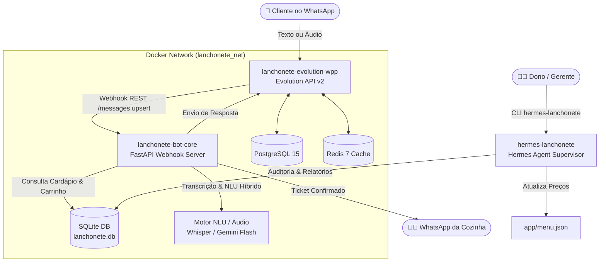

# 🍔 delivery-chatbot

> **Chatbot Autônomo e Sistema de Delivery via WhatsApp para Lanchonetes e Restaurantes**  
> *Arquitetura Code-First Sem N8N • Transcrição de Áudio • Máquina de Estados Determinística • Multi-container Docker • Hermes Agent Supervisor*

---

## 🌟 Destaques do Projeto

* ⚡ **Arquitetura Code-First (Sem N8N):** Em vez de automações visuais pesadas que consomem mais de 1.5 GB de RAM, o sistema roda em microsserviço assíncrono (Python FastAPI) consumindo menos de **40 MB de RAM**.
* 🎙️ **Suporte Nativo a Mensagens de Áudio:** O cliente pode mandar áudio no WhatsApp (*"Me manda um x-bacon sem tomate e uma coca lata"*); o bot transcreve e monta o carrinho automaticamente.
* 🛡️ **Zero Alucinação de Preços e Itens:** O cardápio reside em estrutura rígida (`menu.json`); a computação de centavos, adicionais e frete é 100% determinística.
* 📦 **Totalmente Conteinerizado:** Orquestração completa via Docker Compose (WhatsApp Gateway Evolution API + PostgreSQL + Redis + Core FastAPI + Hermes Agent).
* 🤖 **Hermes Agent como Gerente:** Agente autônomo isolado para o dono da lanchonete gerenciar o cardápio, consultar relatórios de vendas e auditar métricas via terminal (`hermes-lanchonete`).
* 🧾 **Notificação Automática de Balcão/Cozinha:** Ao fechar o pedido (com Pix Copia-e-Cola, Cartão ou Troco para Dinheiro), um ticket pronto é disparado para o WhatsApp da cozinha ou impressora térmica.

---

## 🏗️ Arquitetura do Sistema



---

## 📁 Estrutura de Diretórios

```text
delivery-chatbot/
├── app/                         # Código-fonte do Bot de Atendimento
│   ├── main.py                  # Endpoints FastAPI e roteamento de Webhooks
│   ├── database.py              # Persistência assíncrona SQLite (sessões e pedidos)
│   ├── menu.json                # Cardápio oficial com categorias, preços e aliases
│   ├── state_machine.py         # Máquina de estados (INICIO ➔ PEDIDO ➔ ENTREGA ➔ PIX)
│   ├── agent_llm.py             # NLU Híbrido (Parser determinístico + LLM)
│   ├── audio_transcriber.py     # Transcrição de áudios (.ogg do WhatsApp)
│   ├── whatsapp_client.py       # Wrapper HTTP para a Evolution API
│   ├── requirements.txt         # Dependências Python
│   └── Dockerfile               # Imagem Python 3.11-slim otimizada
├── hermes_data/                 # Dados, SOUL e configurações isoladas do Hermes Gerente
├── data/                        # Volumes persistentes (SQLite, Postgres, Redis, Instâncias)
├── docker-compose.yml           # Orquestrador multi-container de toda a stack
├── runbook-lanchonete-v1.md     # Runbook de instalação, manutenção e testes
├── .env.example                 # Modelo de variáveis de ambiente
└── .gitignore                   # Proteção de bancos, tokens e mídias
```

---

## 🚀 Como Executar

### 1. Clonar o Repositório e Configurar o Ambiente
```bash
git clone https://github.com/brncesarms/delivery-chatbot.git
cd delivery-chatbot
cp .env.example .env
# Edite as variáveis no .env (chaves, nome da lanchonete, taxa de entrega, chave pix)
```

### 2. Subir Todos os Containers
```bash
docker compose up -d
```

### 3. Conectar o WhatsApp
Abra a imagem do QR Code gerada pelo Gateway ou acesse o endpoint:
```bash
# O QR Code é gravado localmente para escaneamento
xdg-open qrcode_whatsapp.png
```
No WhatsApp do celular: **Aparelhos Conectados ➔ Conectar um aparelho**.

---

## 🔌 Endpoints da API

* `GET /health` — Status de saúde do Bot e conectividade com a Evolution API
* `GET /menu` — Cardápio completo formatado em JSON
* `GET /orders` — Consulta dos últimos pedidos registrados
* `POST /webhook` — Endpoint receptor de eventos da Evolution API

---

## 👨‍💼 Comandos do Gerente (Hermes Agent)

O projeto inclui o wrapper determinístico `hermes-lanchonete`:

```bash
# Chat interativo com o Gerente Hermes:
hermes-lanchonete

# Consultar métricas de faturamento em 1 linha:
hermes-lanchonete -z "Quantos pedidos saíram hoje e qual foi o faturamento total?"

# Modificar cardápio de forma autônoma:
hermes-lanchonete -z "Altere o preço da Batata Cheddar e Bacon para R$ 28,00 no menu.json"
```

---

## 📄 Licença
Distribuído sob a licença MIT. Veja `LICENSE` para mais informações.
